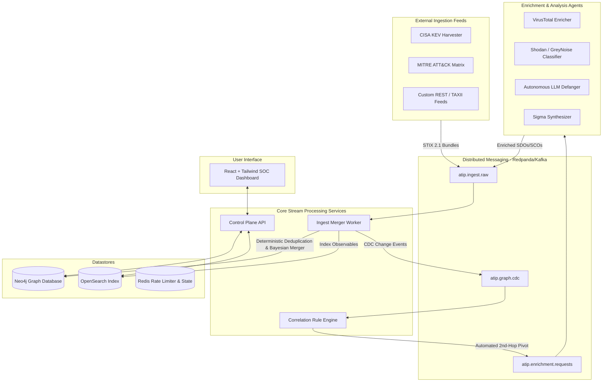

# OpenCTI ATIP Platform (Autonomous Threat Intelligence Platform)

An enterprise-grade, event-driven Cyber Threat Intelligence (CTI) platform inspired by OpenCTI and built on the OASIS STIX 2.1 standard. It features deterministic entity deduplication, multi-source confidence reconciliation, stream processing, and an autonomous AI agent suite.

---

## Architecture Overview



---

## Directory Structure

```text
opencti-atip-platform/
├── .agents/
│   └── workflows/
│       └── connector-builder-workflow.md     # Autonomous connector engineering guide
├── docker-compose.dev.yml                     # Full dev stack: Redpanda, Redis, OpenSearch, Neo4j
├── packages/
│   ├── atip-sdk-python/                       # Core Python SDK: UUIDv5, RateLimiter, BaseConnector
│   │   ├── pyproject.toml
│   │   └── src/atip_sdk/
│   │       ├── __init__.py
│   │       ├── stix_id.py                     # Deterministic UUIDv5 generator (OASIS STIX 2.1)
│   │       ├── base_connector.py              # Abstract connector lifecycle framework
│   │       └── rate_limiter.py                # Redis distributed token-bucket rate limiter
│   └── stix-schema-registry/                  # STIX 2.1 JSON Schema definitions & envelopes
├── services/
│   ├── control-plane-api/                     # FastAPI control plane & agent execution endpoints
│   ├── ingest-merger-worker/                  # Kafka consumer: deterministic deduplication & confidence merger
│   └── correlation-rule-engine/               # Stream processor for graph CDC events & 2nd-hop pivots
├── connectors/
│   ├── external-import/                       # CISA KEV, MITRE ATT&CK, Custom REST Feeds
│   ├── internal-enrichment/                   # VirusTotal, Shodan, GreyNoise, AbuseIPDB
│   └── internal-analysis/                     # LLM unstructured defang & Sigma rule synthesizer
└── webapp/                                    # React + Tailwind Dashboard with Interactive Graph & Agents
    ├── package.json
    ├── tailwind.config.js
    └── src/
        ├── App.jsx                            # High-density SOC Graph & Agent Suite
        └── index.js
```

---

## Key Features

### 1. Deterministic STIX 2.1 UUIDv5 Identifiers
Standard STIX UUIDv4 identifiers cause graph fragmentation when identical indicators are ingested from distinct feeds. ATIP strictly enforces deterministic STIX 2.1 UUIDv5 generation using the OASIS STIX standard namespace (`00abedb4-aa42-466c-9c01-fedf7a7a527b`) and canonical keys:
- Observables (`ipv4-addr`, `domain-name`, `url`): Normalized value string.
- SDOs (`vulnerability`): Canonical uppercase identifier (e.g. `CVE-2024-21887`).
- SROs (`relationship`): `{relationship_type}::{source_ref}::{target_ref}`.

### 2. Bayesian Confidence Merging
When multiple feeds corroborate the same observable or entity, certainty increases asymptotically towards 100%:
$$C_{\text{merged}} = \min(100, C_{\text{old}} + (100 - C_{\text{old}}) \times (C_{\text{incoming}} / 200))$$

### 3. TLP Reconciliation Policy
Merges data honoring the most restrictive classification:
$$\text{TLP:RED} > \text{TLP:AMBER+STRICT} > \text{TLP:AMBER} > \text{TLP:GREEN} > \text{TLP:CLEAR}$$

### 4. Distributed Token Bucket Rate Limiting
Thread-safe and process-safe rate limiting executed directly in Redis via an atomic Lua script, preventing rate limit lockouts on external threat APIs.

---

## Quickstart

### Prerequisites
- Docker & Docker Compose **OR** Python 3.10+ and Node.js 18+

### Running with Docker Compose
```bash
# Launch entire stack (Redpanda, Redis, Neo4j, OpenSearch, Services, WebApp)
docker compose -f docker-compose.dev.yml up --build
```

Access points:
- **Web Dashboard**: `http://localhost:5173`
- **Control Plane API**: `http://localhost:8000/docs`
- **Redpanda Console**: `http://localhost:8080`
- **Neo4j Browser**: `http://localhost:7474` (neo4j / opencti_atip_pass)
- **OpenSearch**: `http://localhost:9200`

### Running the Python SDK & Services Locally
```bash
# 1. Install the SDK in editable mode
cd packages/atip-sdk-python
pip install -e .

# 2. Run the Control Plane API
cd ../../services/control-plane-api
pip install -r requirements.txt
uvicorn main:app --reload --port 8000

# 3. Start the Webapp
cd ../../webapp
npm install
npm run dev
```

---

## Testing & Verification

Run tests to verify deterministic STIX ID generation and rate limiting:
```bash
python3 -c "
from atip_sdk.stix_id import generate_deterministic_stix_id, generate_relationship_stix_id

id1 = generate_deterministic_stix_id('vulnerability', 'cve-2024-21887')
id2 = generate_deterministic_stix_id('vulnerability', 'CVE-2024-21887')
assert id1 == id2, 'Case insensitivity must match'
print('STIX ID Test Passed:', id1)
"
```
